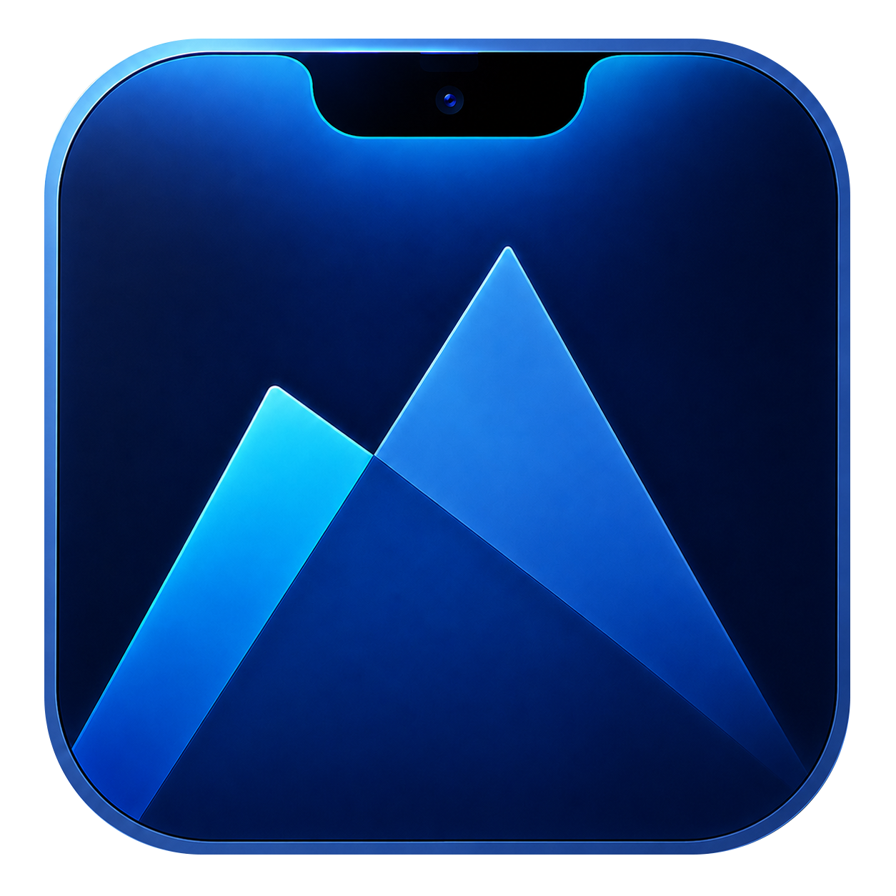

<p align="center">
  
</p>

<h1 align="center">MNotch</h1>

<p align="center">
  A native, local-first Dynamic Island for macOS.<br>
  Turn the MacBook notch—or the top of an external display—into a useful, contextual workspace.
</p>

<p align="center">
  <a href="https://github.com/maclifevn/MNotch/actions/workflows/ci.yml"></a>
  
  
  
  
</p>

<p align="center">
  <a href="https://github.com/maclifevn/MNotch/releases">Download</a>
  ·
  <a href="CHANGELOG.md">Changelog</a>
  ·
  <a href="https://github.com/maclifevn/MNotch/issues/new">Report a bug</a>
</p>

MNotch is an AppKit and SwiftUI menu-bar utility inspired by the fluid interactions of Dynamic Island interfaces. It runs as a lightweight background app, supports both physical and simulated notches, and ships with English and Vietnamese localizations.

## Highlights

The current stability candidate temporarily disables direct private macOS APIs
for display brightness, keyboard backlight and lock-screen overlays until the
hardware/OS compatibility matrix is verified. macOS keeps handling those keys;
volume and the other features remain available. Settings explains this state.
See [AUDIT.md](AUDIT.md) for evidence and remaining release checks.

- **Now Playing** — artwork, animated waveform, seek controls, previous/play/next, output-device status, and configurable quick actions across supported media apps.
- **System HUDs** — replace or complement the standard volume, display-brightness, and keyboard-backlight overlays with compact notch animations.
- **Contextual notifications** — battery, charging, low-power mode, Bluetooth devices, Focus, and upcoming calendar events.
- **File Tray** — drop files onto the notch, select one or many, Quick Look, open, reveal in Finder, AirDrop, or drag them into another app.
- **Calendar and Pomodoro** — see today's and upcoming events, receive quick peeks, and run focus/break cycles without opening another app.
- **Agent Monitor** — review Claude Code and Codex permission requests, jump back to a session, and view live or cached quota windows.
- **Lock-screen widgets** — optional media, calendar, battery, connectivity, Focus, and system-control surfaces.
- **Multi-display support** — target all displays, the main display, the built-in display, or one specific screen. Displays without a hardware cutout use a simulated notch.
- **Signed automatic updates** — daily checks, optional download-on-quit, and manual checks from the menu bar or Settings, protected by Sparkle Ed25519 signatures and Apple notarization.
- **Customizable behavior** — per-feature toggles, gestures, hover/click expansion, idle activities, visual styles, timing, sounds, and launch at login.

## Requirements

| Requirement | Details |
|---|---|
| macOS | macOS 15 Sequoia or later |
| Mac | Apple Silicon (`arm64`) |
| Display | A physical notch is optional; external and notch-free displays are supported |
| Build tools | Swift toolchain and Xcode Command Line Tools |

## Install

1. Download the latest `MNotch.dmg` from [GitHub Releases](https://github.com/maclifevn/MNotch/releases).
2. Open the disk image and drag **MNotch** into **Applications**.
3. Launch MNotch. The distributed build is signed with Developer ID and notarized by Apple.
4. Enable only the permissions required by the features you want to use.

MNotch is an accessory app and does not appear in the Dock. Open Settings from the menu-bar icon or the gear button inside the expanded notch. Quit with <kbd>⌘</kbd><kbd>Q</kbd> or **Settings → General → Quit MNotch**.

## Permissions

Every permission is feature-specific. The rest of MNotch continues to work when an optional permission is denied.

| Permission | Used for | Behavior when denied |
|---|---|---|
| Accessibility | Intercepting volume, brightness, and keyboard-backlight keys so Apple's OSD can be suppressed | The native OSD may appear alongside MNotch |
| Calendars | Calendar activity, event list, indicators, and reminders | Calendar features stay unavailable |
| Bluetooth | Device connection notifications and reported battery levels | Connectivity popups stay unavailable |
| Full Disk Access | Reading the current Focus state from macOS | Focus integration disables itself safely |
| Automation / Apple Events | Actions such as favoriting in Music or returning to an agent terminal | macOS asks only when the relevant action is used |

If you build locally and grant Accessibility access, use the stable development-signing setup in [`Scripts/sign-cert-setup.md`](Scripts/sign-cert-setup.md). Ad-hoc signatures change identity between builds and can cause macOS to reset TCC permissions.

## Privacy and local data

MNotch is designed to keep its work on your Mac:

- There is no analytics or telemetry SDK.
- Preferences are stored locally through macOS user defaults.
- The File Tray stores its working copies under `~/Library/Application Support/MNotch/Shelf`. When “clear after drag” is enabled, a hidden backing copy can remain for up to 24 hours so receiving apps can finish an import or upload safely.
- Agent hooks communicate with MNotch over a token-protected listener bound to `127.0.0.1`. Hook installation is explicit and reversible in Settings.
- Codex quota is requested through the local Codex App Server. Claude usage is requested from the locally installed Claude CLI. MNotch does not read agent transcripts or macOS Keychain credentials.
- **Settings → About → Export Diagnostics** saves a local JSON report containing
  app/OS versions, service states and bounded numeric error/timing metadata. It
  excludes tokens, account details, file contents, paths and conversations.
  Nothing is uploaded automatically. See [AUDIT.md](AUDIT.md) for crash/hang reports.

## Build from source

Install Xcode Command Line Tools if needed:

```sh
xcode-select --install
```

Clone, test, and run:

```sh
git clone https://github.com/maclifevn/MNotch.git
cd MNotch

swift test
Scripts/run.sh
```

`Scripts/run.sh` closes an existing MNotch process, assembles `build/MNotch.app`, signs it with the local `MNotch Dev` identity when available (or ad-hoc otherwise), and opens the app. The vendored MediaRemote adapter is built automatically on first use; Xcode itself is not required.

Useful development commands:

```sh
swift build                  # Debug SwiftPM build
swift test                   # Core logic test suite
Scripts/build.sh             # Assemble build/MNotch.app
Scripts/build-adapter.sh     # Rebuild the MediaRemote framework
Scripts/build-update-feed.sh # Sign and verify the Sparkle appcast
```

## Architecture

MNotch keeps the window shell stable and animates only its SwiftUI content. Long-running services are demand-driven and pause expensive polling while the display sleeps.

| Area | Responsibility |
|---|---|
| [`Sources/MNotch/Window`](Sources/MNotch/Window) | Non-activating `NSPanel`, multi-display placement, pointer pass-through, and lock-screen presentation |
| [`Sources/MNotch/Shape`](Sources/MNotch/Shape) | Animatable physical/simulated notch geometry |
| [`Sources/MNotch/State`](Sources/MNotch/State) | View state machine, animation policy, settings, and panel sizing |
| [`Sources/MNotch/Views`](Sources/MNotch/Views) | SwiftUI surfaces for media, HUDs, activities, files, agents, and Settings |
| [`Sources/MNotch/Services`](Sources/MNotch/Services) | Media, audio, displays, power, Bluetooth, calendar, Focus, agents, and lifecycle-aware watchers |
| [`Sources/MNotch/App/FeatureCoordinator.swift`](Sources/MNotch/App/FeatureCoordinator.swift) | Central demand calculation and service start/stop/reconfiguration |
| [`Tests/MNotchTests`](Tests/MNotchTests) | Core policy, parser, lifecycle, state, and regression tests |

CI runs on macOS 15 and 26, validating relay/release scripts, debug/release tests, real Sparkle signing fixtures, release assembly, metadata and signatures. Separate jobs run Address Sanitizer and Thread Sanitizer.

## Compatibility notes

MNotch uses private or undocumented macOS interfaces for media information, brightness control, and optional lock-screen placement. These integrations are isolated and designed to fail closed, but a future macOS update can still change or remove them. Please include your macOS version, Mac model, display arrangement, and reproduction steps when filing a compatibility issue.

The “hide from screen capture” setting only affects compatible legacy capture paths. Modern screen recorders can still capture the complete display.

## Release process

The release scripts require a valid Developer ID Application certificate and a `notarytool` Keychain profile named `MNotch-notary` (both names can be overridden with environment variables).

```sh
make release VERSION=X.Y.Z  # Build/sign/notarize ZIP + DMG, sign/verify feed
make publish VERSION=X.Y.Z  # Upload draft assets, then publish completed release
```

Commit/tag the tested source and add `ReleaseNotes/X.Y.Z.md` first. Prepared
artifacts and SHA-256 manifest are saved under `build/releases/X.Y.Z-BUILD/`.
Production signing uses the existing Keychain key, as in MFinder. Sparkle waits
for File Tray work before installing; cancelling the wait resumes normal use.
See [`RELEASING.md`](RELEASING.md) for the signing-key backup, bootstrap,
GitHub Release, phased-rollout, and rollback checklist.

## Contributing

Issues and pull requests are welcome.

1. Search existing issues before opening a new one.
2. Keep each change focused and explain the user-visible behavior it affects.
3. Add or update regression tests for logic changes.
4. Run `swift test` and `git diff --check` before submitting a pull request.

For bugs involving permissions or agents, remove account names, file contents, tokens, and other sensitive information from logs and screenshots.

## Third-party software and trademarks

MNotch vendors [`mediaremote-adapter`](https://github.com/ungive/mediaremote-adapter), distributed under the BSD 3-Clause License in [`Vendor/mediaremote-adapter/LICENSE`](Vendor/mediaremote-adapter/LICENSE), and uses [Sparkle 2](https://github.com/sparkle-project/Sparkle), distributed under its permissive license and bundled with the release app.

MNotch is an independent project and is not affiliated with Apple, Alcove, Anthropic, or OpenAI. Apple, macOS, MacBook, and related marks are trademarks of Apple Inc. Other product names belong to their respective owners.
